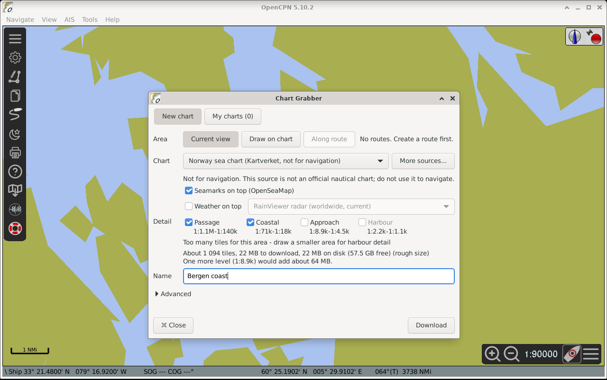
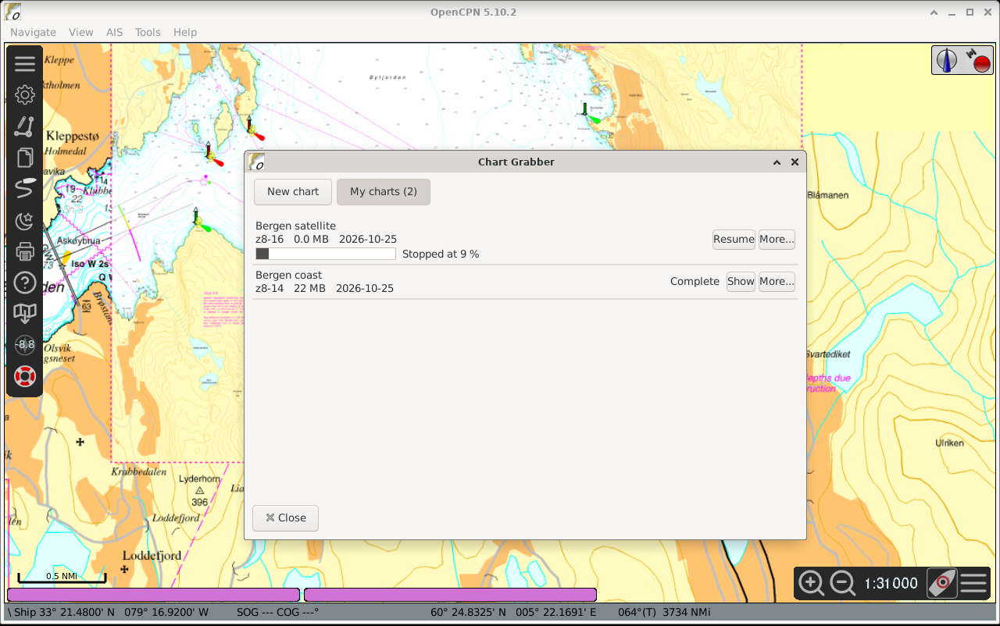
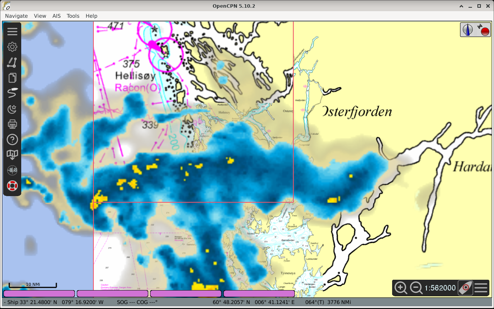

# Chart Grabber (`chartgrabber_pi`)

An OpenCPN plugin: pick an area on the chart (the current view, a drawn rectangle, or a corridor along a route), a
chart source and the detail levels. The plugin runs **Chart Grabber CLI** as a child process; the CLI downloads the
tiles and exports them to MBTiles; the plugin adds the result to OpenCPN's chart database, so the chart works without
internet afterwards.

Display name "Chart Grabber"; OpenCPN common name `ChartGrabber`; library `libchartgrabber_pi.so`.
Version 2026.10.4. Source for release binaries: tag `v2026.10.4`. User guide: [docs/user-guide.md](docs/user-guide.md).


*New chart: pick an area, a source and seamarks on top, and see the estimate before downloading.*


*My charts: your downloaded charts; stop, resume and update.*


*Weather on top: today's rain radar over your chart, refreshed with Update to latest weather.*

## Requirements

- OpenCPN 5.10.2 or newer (plugin API 1.18), Linux, wxWidgets 3.2 / GTK 3 (the build OpenCPN itself uses). On Windows the
  plugin is a 32-bit build for OpenCPN 5.10.2 and newer; the Chart Grabber CLI comes there as its own zip.
- OpenCPN from your distribution must be 5.10.2 or newer. Ubuntu 24.04 ships 5.8.4, which is too old: install OpenCPN from
  the OpenCPN PPA (`ppa:opencpn/opencpn`; the version it offers for 24.04 was not checked). Debian 12 gets 5.10.2 from
  bookworm-backports (`apt install -t bookworm-backports opencpn`). Debian 13 and Ubuntu 26.04 ship a sufficient one.
- **Chart Grabber CLI 2026.10.9 or newer** (the tile program, executable `chart-grabber-cli`). The plugin does not
  contain it. The CLI comes as one `.deb` per system (same package name): Debian 12 amd64, Debian 13 amd64 / arm64,
  Ubuntu 24.04 and 26.04 amd64 / arm64. The plugin looks for it at `/usr/bin/chart-grabber-cli`, else on `PATH`; the path is also a setting
  (Chart Grabber settings, "Tile program"). The settings page shows "Chart Grabber CLI 2026.10.10 is ready." when it is
  found and new enough; an older CLI is reported as too old.
  Download it from the Chart Grabber CLI releases: https://github.com/Sea-For-Friends/chart-grabber-cli/releases

## Install a release tarball

1. Download the tarball that matches your system from the GitHub Releases page (one tarball per OpenCPN host tuple;
   the release notes list which). OpenCPN refuses a tarball made for another host, and a wrong one must not be forced.
2. In OpenCPN: Options, Plugins, **Import plugin...** and pick the downloaded `.tar.gz` (Plugin Manager import).
3. Find Chart Grabber in the plugin list, **Enable** it, then open **Preferences** and set the tile program (the CLI)
   if it is not at `/usr/bin/chart-grabber-cli`. The Chart Grabber icon appears on the OpenCPN toolbar.
4. Toolbar icon, New chart: draw an area, choose a base chart (optionally seamarks or weather on top) and the detail
   levels, wait for the size estimate, press Download. When it ends the chart is in My charts and in OpenCPN's chart
   list.

Saved charts go to `~/Charts/ChartGrabber` by default. The chart sources (ZMP definitions) are bundled; you can
point the settings at your own folder of `.zmp` sources too (see `data/sources/README.md` for the terms of each).

## Chart sources

The plugin ships 24 chart sources in `data/sources/`, in seven groups that the New chart page shows as menus. Each was
tried with the tile program and a real small download. Details, terms and credits per source: `data/sources/README.md`.

| Group | What it is for a sailor |
|---|---|
| Nautical charts | Official sea charts as tiles: Norway (Kartverket), Finland (Traficom), the US coast (NOAA). Not for navigation. |
| Seamarks and traffic | OpenSeaMap seamarks (buoys, lights) and EMODnet ship traffic density, as overlays on a chart. |
| Depth | Depth shading: EMODnet (Europe, world), GEBCO (world), NOAA BlueTopo (US coast). Not for navigation. |
| Satellite | Sentinel-2 (10 m, worldwide), USGS (USA), Esri World Imagery (grey: its terms may forbid offline use). |
| Coast and land | OpenTopoMap, a land and relief chart (grey: throttled, one connection). |
| Weather now | One picture of the weather as it is now: rain radar, clouds, precipitation (Europe, US, worldwide). |
| Ocean | Sea surface temperature and sea ice, one daily picture. |

The satellite gap: what sailors ask for most, Google, Bing and Esri high-resolution imagery for reefs, cannot be shipped;
those providers forbid saving their tiles. The imagery that can be shipped, Sentinel-2 at 10 m and USGS, shows reef edges,
banks and passes, but not single coral heads.

Sources that need a key, and Navionics, are not in this repository. They live in a separate folder outside it, one folder
with a short README per source. To add one, put its `.zmp` folder (with your own key where the file says `KEY`) into a
folder of your own (by default `Charts/Chart sources` in your home folder) and, if you use another folder, choose it in
Preferences, row "Chart sources"; it is read after the bundled sources.

## Build from source

Dependencies (Debian / Ubuntu package names): `cmake` (3.20 or newer), `ninja-build` (or make), `g++` with C++23
(GCC 13 or newer), `pkg-config`, `libwxgtk3.2-dev`, `libgtk-3-dev`, `libgl-dev`, `libgtest-dev`; for the window tests
also `xvfb` and `xauth`. On Arch: `wxwidgets-gtk3 gtk3 gtest cmake ninja xorg-server-xvfb`.

```
cmake -S . -B build -G Ninja -DCMAKE_BUILD_TYPE=Release \
      -DCG_TARGET=debian-x86_64 -DCG_TARGET_VERSION=n/a
cmake --build build
ctest --test-dir build --output-on-failure
```

`CG_TARGET`, `CG_TARGET_VERSION` and `CG_TARGET_ARCH` fill `metadata.xml`: they must equal the host tuple of the
OpenCPN you import the plugin into (for example `debian-x86_64` / `12`, `debian-arm64` / `n/a`, `ubuntu-x86_64` /
`24.04`; `CG_TARGET_ARCH` defaults to the build machine). `CG_TARGET=all` is refused: the plugin links wxWidgets, whose
ABI differs between distributions. Build the tarball on the same kind of system it is for, never cross-built.
Tests: `-DCG_BUILD_TESTS=OFF` skips them; the window tests run on a private Xvfb, never on your desktop.

Pack the Plugin Manager tarball (`metadata.xml`, `usr/lib/opencpn/libchartgrabber_pi.so`,
`usr/share/opencpn/plugins/chartgrabber_pi/data/...`):

```
tools/tarball.sh build [out-dir]
```

The tarball is byte-reproducible for one build directory; outside a git checkout set `SOURCE_DATE_EPOCH`.

## Layout

```
CMakeLists.txt            top-level project
api/ocpn_plugin.h         OpenCPN plugin API 1.18, vendored unmodified (GPL-2.0-or-later), see api/README.md
src/core/                 plain C++ without wx: CLI records, exit codes, geometry, detail bands, job files
src/wx/                   plugin class, dialogs (New chart / My charts), child process, progress strip, area overlay
data/                     toolbar icons; data/sources: bundled chart sources (CC0) with LICENSE, NOTICE, PROVENANCE
packaging/metadata.xml.in Plugin Manager metadata template
tests/                    GoogleTest unit and window tests, fixtures captured from the CLI
tools/                    tarball.sh (packaging), xvfb_test.sh (window test launcher)
```

The plugin talks to the CLI only through its command line, its stdout / stderr records and its exit codes; it links no
CLI code and uses no Qt. Everything that is not a window lives in `src/core/` and is unit-tested.

## Licence

GPL-3.0-or-later, see `LICENSE`. `api/ocpn_plugin.h` is OpenCPN's own header (GPL-2.0-or-later). The chart source
definitions in `data/sources` are CC0-1.0; see `data/sources/LICENSE`, `NOTICE` and `PROVENANCE.md`.

## Release files

- One GitHub Release per version (tag `v<version>`), all platform tarballs as assets, each with a `.sha256` next to it.
- Name: `chartgrabber_pi-<version>-<target>-<target-version-for-humans>-<arch>.tar.gz`, for example
  `chartgrabber_pi-2026.10.4-debian-x86_64-13-x86_64.tar.gz`. The top directory inside has the same name without `.tar.gz`.
  The file name never matters to OpenCPN's import; it is for you to pick the right file.
- `metadata.xml` carries the OpenCPN host tuple exactly (`<target>`, `<target-version>`): `lsb_release -is` / `-rs`
  lowercased plus the architecture; Ubuntu needs the exact version, other systems the major. Debian 13 (trixie) builds
  of OpenCPN report `n/a` as the version, so its tarballs say `n/a` in `metadata.xml` and `13` in the file name; Arch and
  CachyOS use `rolling`. A Debian 12 tarball is also accepted by OpenCPN on Ubuntu 23.04 to 24.04.
- The repository is `chartgrabber_pi`: `_pi` is OpenCPN's suffix for plugins.
