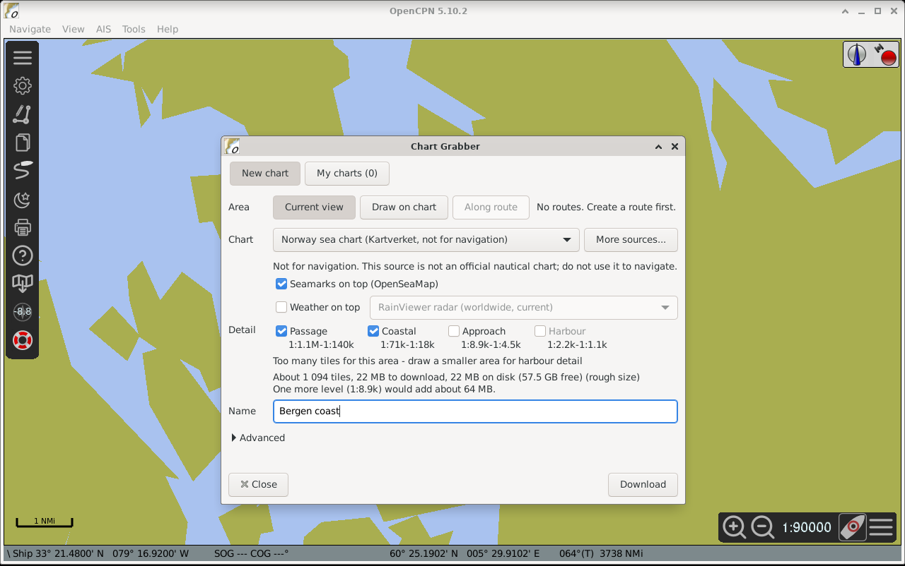
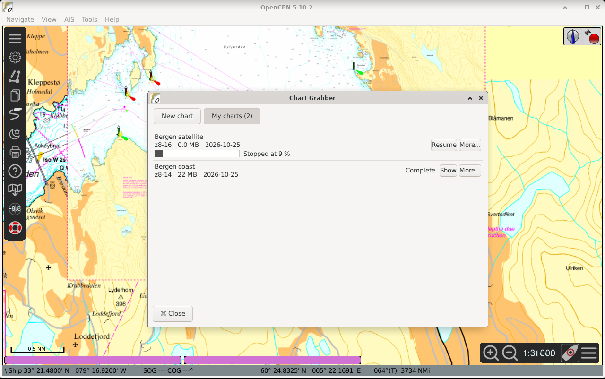
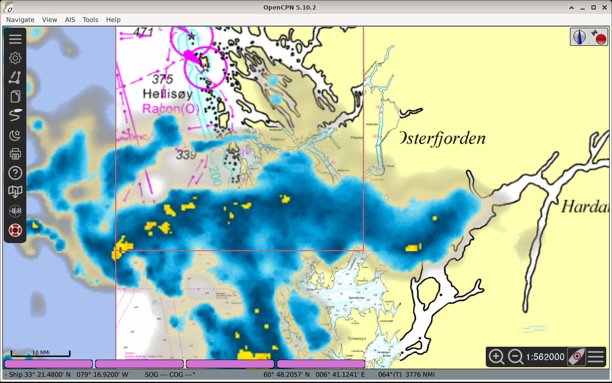

# Chart Grabber

Chart Grabber is an OpenCPN plugin that saves charts for offline use. Pick an area on the chart: the current view, a
rectangle you draw, or a corridor along your route. Choose a chart source and how much detail you want. Chart Grabber
downloads it and adds it to OpenCPN's chart list. The chart then works with no internet, far from shore.

*New chart: pick an area, a source and seamarks on top, and see the estimate before downloading.*

*My charts: your downloaded charts; stop, resume and update.*

*Weather on top: today's rain radar over your chart, refreshed with Update to latest weather.*

The download itself is done by a separate program, the [Chart Grabber CLI](https://github.com/Sea-For-Friends/chart-grabber-cli). [Chart Grabber CLI](https://github.com/Sea-For-Friends/chart-grabber-cli) is an independent port of
SAS.Planet ([sasgis/sas.planet.src](https://github.com/sasgis/sas.planet.src)) to C++ and Qt. It is not an official
SAS.Planet project. Thanks to the SAS.Planet authors.

User guide: [docs/user-guide.md](docs/user-guide.md).

**Not for navigation.** The charts are copies of online sources. Always carry official charts.

## What you need

OpenCPN 5.10.2 or newer, on one of these systems:

- Debian 12: 64-bit PC and ARM 64-bit
- Debian 13: 64-bit PC and ARM 64-bit
- Raspberry Pi OS 64-bit (bookworm and trixie, which are Debian 12 and 13): ARM 64-bit
- Ubuntu 24.04 and 26.04: 64-bit PC and ARM 64-bit
- Arch and CachyOS: 64-bit PC
- Raspberry Pi OS 32-bit (Trixie) and Debian 12 / 13 armhf: 32-bit ARM, Pi 2 and newer (not the Pi Zero, Zero W or Pi 1)
- Windows 10/11: 64-bit PC
- macOS 12 or newer: Apple and Intel Macs
- Flatpak OpenCPN from Flathub, version 5.12 (runtime 24.08) or 5.14 (runtime 25.08): 64-bit PC and ARM 64-bit. OpenCPN 5.10.2 on Flatpak is not served, Flathub no longer has it. Keep your chart folder inside your home folder

Ubuntu 24.04 needs OpenCPN from the OpenCPN PPA.
Debian 12 gets OpenCPN from bookworm-backports.

## Install

1. Download the plugin file for your system (the table below).
2. In OpenCPN: Options > Plugins > **Import plugin...**, pick the plugin file, **Enable** it, then **OK** (or restart OpenCPN).

The [Chart Grabber CLI](https://github.com/Sea-For-Friends/chart-grabber-cli) 2026.11.1, the program that does the download, is inside the plugin file on every system: there is nothing else to install.
It is kept in the plugin folder of OpenCPN. A CLI you choose yourself in the plugin's Settings is used instead.
The Linux file needs the graphics libraries `libopengl0`, `libglx0` and `libegl1`; OpenCPN's own package from Debian 12, Debian 13 or Ubuntu 24.04 installs them, a hand-built OpenCPN may not (Arch and CachyOS: `libglvnd`).

Chart Grabber is not in OpenCPN's plugin catalog yet. Once it is listed, you can install and update it from the Plugin Manager; until then, and on Arch and CachyOS, use **Import plugin...** as above.

### Updating from 2026.10.4 or older

Import the new plugin file over the old one. The plugin then uses its own CLI; the Chart Grabber CLI you installed separately is no longer needed (keep it if you use it in scripts).
Exception: if you once chose a CLI yourself under Settings > Advanced > **Chart Grabber CLI**, the plugin keeps using that one. Click **Use default** in that row to switch to the CLI inside the plugin.

## Downloads

| System | Plugin | [Chart Grabber CLI](https://github.com/Sea-For-Friends/chart-grabber-cli) |
|---|---|---|
| Debian 12, 64-bit PC | [chartgrabber_pi-2026.10.7-debian-x86_64-12-x86_64.tar.gz](https://github.com/Sea-For-Friends/chartgrabber_pi/releases/download/v2026.10.7/chartgrabber_pi-2026.10.7-debian-x86_64-12-x86_64.tar.gz) | included |
| Debian 13, 64-bit PC | [chartgrabber_pi-2026.10.7-debian-x86_64-13-x86_64.tar.gz](https://github.com/Sea-For-Friends/chartgrabber_pi/releases/download/v2026.10.7/chartgrabber_pi-2026.10.7-debian-x86_64-13-x86_64.tar.gz) | included |
| Debian 12 and Raspberry Pi OS bookworm, ARM 64-bit | [chartgrabber_pi-2026.10.7-debian-arm64-12-arm64.tar.gz](https://github.com/Sea-For-Friends/chartgrabber_pi/releases/download/v2026.10.7/chartgrabber_pi-2026.10.7-debian-arm64-12-arm64.tar.gz) | included |
| Debian 13 and Raspberry Pi OS trixie, ARM 64-bit | [chartgrabber_pi-2026.10.7-debian-arm64-13-arm64.tar.gz](https://github.com/Sea-For-Friends/chartgrabber_pi/releases/download/v2026.10.7/chartgrabber_pi-2026.10.7-debian-arm64-13-arm64.tar.gz) | included |
| Ubuntu 24.04, 64-bit PC | [chartgrabber_pi-2026.10.7-debian-x86_64-12-x86_64.tar.gz](https://github.com/Sea-For-Friends/chartgrabber_pi/releases/download/v2026.10.7/chartgrabber_pi-2026.10.7-debian-x86_64-12-x86_64.tar.gz) | included |
| Ubuntu 24.04, ARM 64-bit | [chartgrabber_pi-2026.10.7-debian-arm64-12-arm64.tar.gz](https://github.com/Sea-For-Friends/chartgrabber_pi/releases/download/v2026.10.7/chartgrabber_pi-2026.10.7-debian-arm64-12-arm64.tar.gz) | included |
| Ubuntu 26.04, 64-bit PC | [chartgrabber_pi-2026.10.7-ubuntu-x86_64-26.04-x86_64.tar.gz](https://github.com/Sea-For-Friends/chartgrabber_pi/releases/download/v2026.10.7/chartgrabber_pi-2026.10.7-ubuntu-x86_64-26.04-x86_64.tar.gz) | included |
| Ubuntu 26.04, ARM 64-bit | [chartgrabber_pi-2026.10.7-ubuntu-arm64-26.04-arm64.tar.gz](https://github.com/Sea-For-Friends/chartgrabber_pi/releases/download/v2026.10.7/chartgrabber_pi-2026.10.7-ubuntu-arm64-26.04-arm64.tar.gz) | included |
| Arch, 64-bit PC | [chartgrabber_pi-2026.10.7-arch-x86_64-rolling-x86_64.tar.gz](https://github.com/Sea-For-Friends/chartgrabber_pi/releases/download/v2026.10.7/chartgrabber_pi-2026.10.7-arch-x86_64-rolling-x86_64.tar.gz) | included |
| CachyOS, 64-bit PC | [chartgrabber_pi-2026.10.7-cachyos-x86_64-rolling-x86_64.tar.gz](https://github.com/Sea-For-Friends/chartgrabber_pi/releases/download/v2026.10.7/chartgrabber_pi-2026.10.7-cachyos-x86_64-rolling-x86_64.tar.gz) | included |
| Windows 10/11, 64-bit PC | [chartgrabber_pi-2026.10.7-windows-x86.tar.gz](https://github.com/Sea-For-Friends/chartgrabber_pi/releases/download/v2026.10.7/chartgrabber_pi-2026.10.7-windows-x86.tar.gz) | included |
| Debian 12, 32-bit ARM (armhf) | [chartgrabber_pi-2026.10.7-debian-armhf-12-armhf.tar.gz](https://github.com/Sea-For-Friends/chartgrabber_pi/releases/download/v2026.10.7/chartgrabber_pi-2026.10.7-debian-armhf-12-armhf.tar.gz) | included |
| Debian 13, 32-bit ARM (armhf) | [chartgrabber_pi-2026.10.7-debian-armhf-13-armhf.tar.gz](https://github.com/Sea-For-Friends/chartgrabber_pi/releases/download/v2026.10.7/chartgrabber_pi-2026.10.7-debian-armhf-13-armhf.tar.gz) | included |
| Raspberry Pi OS 32-bit (Trixie) | [chartgrabber_pi-2026.10.7-raspbian-armhf-13-armhf.tar.gz](https://github.com/Sea-For-Friends/chartgrabber_pi/releases/download/v2026.10.7/chartgrabber_pi-2026.10.7-raspbian-armhf-13-armhf.tar.gz) | included |
| macOS 12 or newer, Apple and Intel | [chartgrabber_pi-2026.10.7-macos-universal.tar.gz](https://github.com/Sea-For-Friends/chartgrabber_pi/releases/download/v2026.10.7/chartgrabber_pi-2026.10.7-macos-universal.tar.gz) | included |
| Flatpak OpenCPN 5.12, 64-bit PC | [chartgrabber_pi-2026.10.7-flatpak-x86_64-24.08-x86_64.tar.gz](https://github.com/Sea-For-Friends/chartgrabber_pi/releases/download/v2026.10.7/chartgrabber_pi-2026.10.7-flatpak-x86_64-24.08-x86_64.tar.gz) | included |
| Flatpak OpenCPN 5.12, ARM 64-bit | [chartgrabber_pi-2026.10.7-flatpak-aarch64-24.08-aarch64.tar.gz](https://github.com/Sea-For-Friends/chartgrabber_pi/releases/download/v2026.10.7/chartgrabber_pi-2026.10.7-flatpak-aarch64-24.08-aarch64.tar.gz) | included |
| Flatpak OpenCPN 5.14, 64-bit PC | [chartgrabber_pi-2026.10.7-flatpak-x86_64-25.08-x86_64.tar.gz](https://github.com/Sea-For-Friends/chartgrabber_pi/releases/download/v2026.10.7/chartgrabber_pi-2026.10.7-flatpak-x86_64-25.08-x86_64.tar.gz) | included |
| Flatpak OpenCPN 5.14, ARM 64-bit | [chartgrabber_pi-2026.10.7-flatpak-aarch64-25.08-aarch64.tar.gz](https://github.com/Sea-For-Friends/chartgrabber_pi/releases/download/v2026.10.7/chartgrabber_pi-2026.10.7-flatpak-aarch64-25.08-aarch64.tar.gz) | included |

Checksums are on the release page. All releases: [plugin](https://github.com/Sea-For-Friends/chartgrabber_pi/releases),
[Chart Grabber CLI](https://github.com/Sea-For-Friends/chart-grabber-cli/releases).

## Chart sources

The plugin ships 81 chart sources in `data/sources/` as `*.source.json` files (the CLI's JSON format), in seven groups that the New chart page shows as menus. Each was
tried with the tile program and a real small download. Details, terms and credits per source: `data/sources/README.md`.

| Group | What it is for a sailor |
|---|---|
| Nautical charts | Official sea charts as tiles: Norway (Kartverket), Finland (Traficom), the US coast (NOAA). Not for navigation. |
| Seamarks and traffic | OpenSeaMap seamarks (buoys, lights) and EMODnet ship traffic density, as overlays on a chart. |
| Depth | Depth shading: EMODnet (Europe, world), GEBCO (world), NOAA BlueTopo (US coast), CHS NONNA-10 (Canada). Not for navigation. |
| Satellite | Sentinel-2 (10 m, worldwide), USGS (USA), Esri World Imagery (grey: its terms may forbid offline use). |
| Coast and land | OpenTopoMap, a land and relief chart (grey: throttled, one connection). |
| Weather now | One picture of the weather as it is now: rain radar, clouds, precipitation, tropical cyclones, US weather warnings (Europe, US, worldwide). |
| Ocean | Sea surface temperature and sea ice (one daily picture), surface currents of the US East and West coast waters (a model's picture). |

The satellite gap: what sailors ask for most, Google, Bing and Esri high-resolution imagery for reefs, cannot be shipped;
those providers forbid saving their tiles. The imagery that can be shipped, Sentinel-2 at 10 m and USGS, shows reef edges,
banks and passes, but not single coral heads.

Sources that need a key are not in this repository. They live in a separate folder outside it, one folder
with a short README per source. To add one, put its `.zmp` folder or `.source.json` file (with your own key where the file says `KEY`) into a
folder of your own (by default `Charts/Chart sources` in your home folder) and, if you use another folder, choose it in
Preferences, row "Chart sources"; it is read after the bundled sources.

Package repository hosting is graciously provided by [Cloudsmith](https://cloudsmith.com).

## Licence

GPL-3.0-or-later, see `LICENSE`. `api/ocpn_plugin.h` is OpenCPN's own header (GPL-2.0-or-later). The chart source
definitions in `data/sources` are CC0-1.0; see `data/sources/LICENSE`, `NOTICE` and `PROVENANCE.md`.

## For developers

How to build the plugin: [docs/build.md](docs/build.md).
