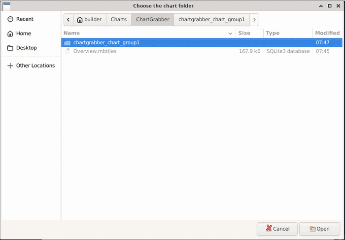
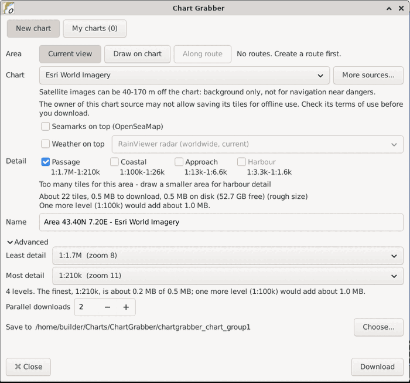
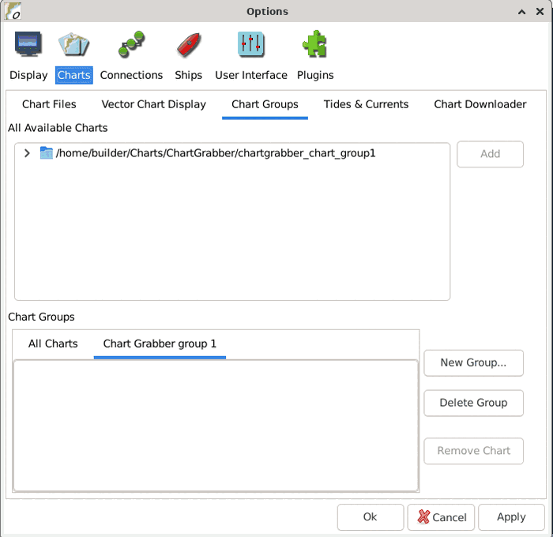
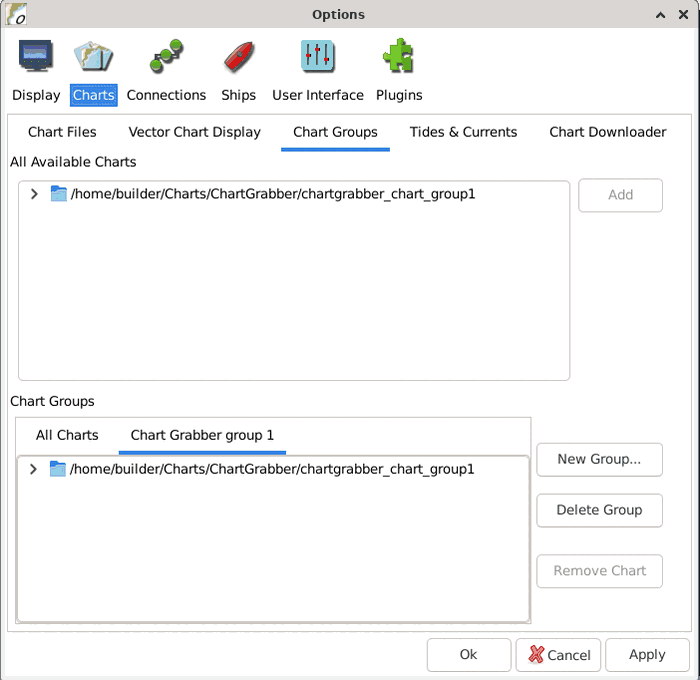
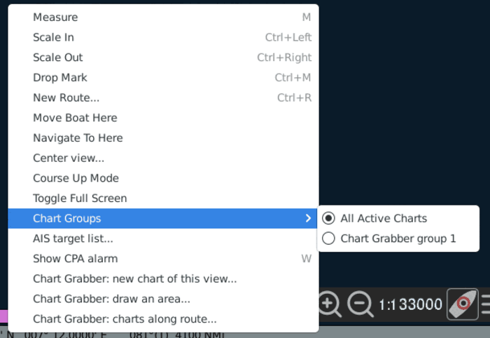

# Keep many charts in order with chart groups

After many downloads, the chart bar at the bottom of OpenCPN has many keys. The charts are hard to manage.

The fix: put the charts of one trip or one area into one folder. Make that folder a chart group in OpenCPN. Then switch groups. One switch shows or hides all the charts of that folder.

This page shows the steps with Chart Grabber 2026.11.6. The screenshots come from Linux. The windows on other systems look different but have the same names.

## Step 1. Make a folder and download a chart into it

1. Open Chart Grabber. Stay on **New chart**.
2. Choose a small area. Choose a fast chart source. Tick **Passage** only. A small first chart is enough for a test.
3. Open **Advanced**. The line **Save to** shows the folder for the new chart. The default is `Charts/ChartGrabber` in your home folder.

Make a new folder for the group before you continue. Name it `chartgrabber_chart_group1`. Make it inside `Charts/ChartGrabber`.

The folder window of OpenCPN has no button to make a folder. We checked this on Linux only. Use your file manager. If `Charts/ChartGrabber` does not exist yet, make `Charts` and `ChartGrabber` first.

4. Click **Choose...** next to **Save to**.
5. Go to `Charts/ChartGrabber`. Click the folder `chartgrabber_chart_group1` once. Click **Open**.

6. Check that **Save to** shows the new folder.

7. Click **Download**. Click **OK** in the message "Not official charts".

Chart Grabber adds the new folder to the list of chart folders of OpenCPN. You can see it in Options, Charts, **Chart Files**.

Look at **Save to** before each download. A chart goes to the folder that **Save to** shows.

## Step 2. Make a chart group

1. Click the gear icon in OpenCPN to open Options.
2. Click **Charts**. Click the tab **Chart Groups**.
3. Click **New Group...**.
4. Type a name, for example `Chart Grabber group 1`. Click **OK**.

The new group appears as a tab. The tab is empty.

## Step 3. Add the folder to the group

1. Stay in Options, Charts, **Chart Groups**. Click the tab of your new group.
2. In the list **All Available Charts**, click the folder `chartgrabber_chart_group1`.
3. Click **Add**. The folder now shows in the list of the group.
4. Click **Ok** to close Options.

You add the folder, not single charts. A group that holds a folder includes all charts in this folder and in its sub-folders.

## Step 4. Switch groups

1. Right-click the chart in OpenCPN.
2. Point at **Chart Groups**.
3. Click the name of your group.

The chart bar now shows only the charts of this group. To see all charts again, choose **All Active Charts** in the same menu.

In this example, OpenCPN has three charts. Two charts are in the folder of the group. One chart is in the default folder, outside the group. The first picture shows **All Active Charts**: three keys.

The second picture shows the group: two keys. The chart outside the group is hidden. Hidden charts stay on your disk.

## New charts join the group

Download the next chart of the same trip into the same folder. Use **Save to** as in step 1. The chart is now in the group. You do not add it by hand.

When the new chart shows in the group depends on your OpenCPN version:

- **OpenCPN 5.14** (we tested 5.14.2): the chart shows in the group at once. A restart is not needed.
- **OpenCPN 5.10** (we tested 5.10.2): the new chart shows in **All Active Charts** at once. It joins the group only after you restart OpenCPN. After the restart, OpenCPN showed a message that it must update the chart database. Click **OK**. OpenCPN then showed all charts again. Choose your group again.

## More groups

Make one folder and one group for each trip or area. Use the same steps. For example, use the folder `chartgrabber_chart_group2` and the group `Chart Grabber group 2`. Switch between the groups with the menu in step 4.
