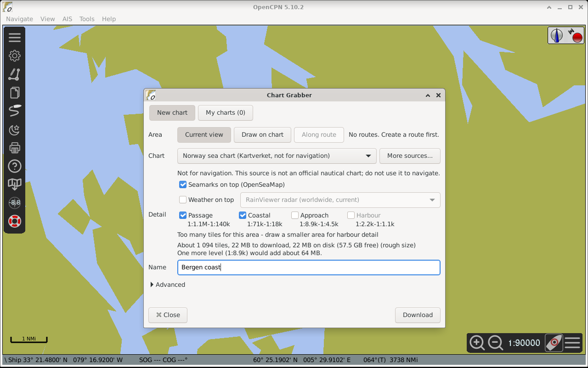
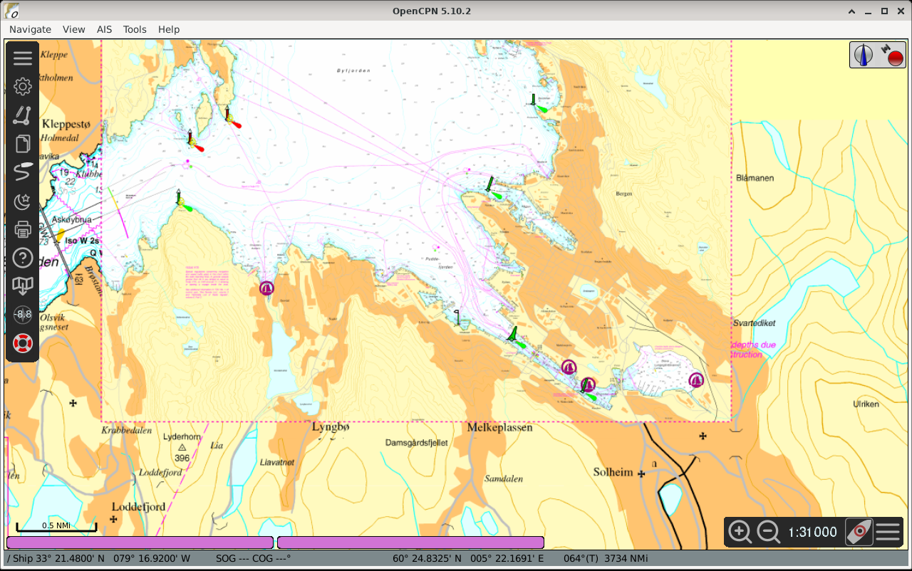
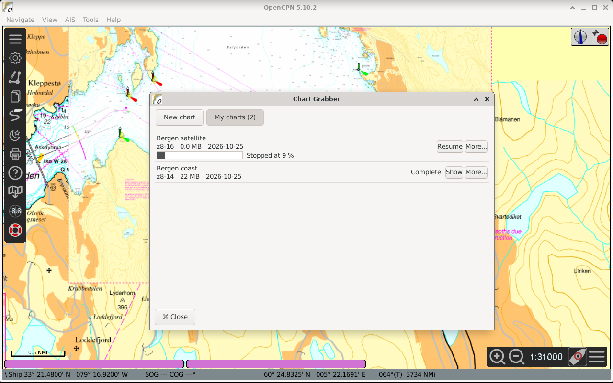
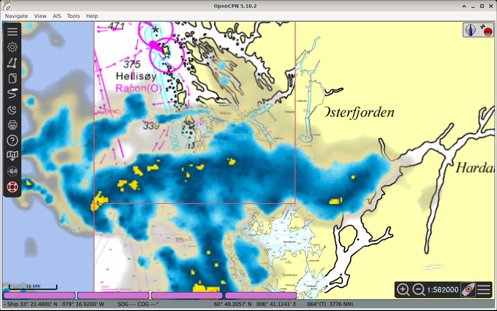

# Chart Grabber user guide

## Contents

1. [What it is](#what-it-is)
2. [What problems it solves](#what-problems-it-solves)
3. [Install](#install)
4. [First chart in 2 minutes](#first-chart-in-2-minutes)
5. [Bundled charts](#bundled-charts)
6. [Everyday use](#everyday-use)
7. [Weather](#weather)
8. [At sea and on slow links](#at-sea-and-on-slow-links)
9. [Your own sources](#your-own-sources)
10. [Settings reference](#settings-reference)
11. [Troubleshooting](#troubleshooting)
12. [Help and licence](#help-and-licence)

## What it is

Chart Grabber is an OpenCPN plugin that downloads charts for offline use. You pick an area (the current view, a rectangle you draw, or a corridor along a route), a chart source and the level of detail; the Chart Grabber CLI downloads it in the background, and the result is added to OpenCPN as an MBTiles chart.

**Not official charts. Do not use for navigation alone. Respect the terms of use of each chart source.**

## What problems it solves

Getting online charts into OpenCPN for offline use used to take several programs: download tiles with SAS.Planet or Mobile Atlas Creator (MOBAC), sometimes process them in QGIS, convert them to a format OpenCPN reads (MBTiles or KAP), then add the folder to OpenCPN. With Chart Grabber it is one dialog inside OpenCPN, and the chart appears in OpenCPN's chart list. Resuming, updating and refreshing weather are handled too.

Chart Grabber has two parts:

- **The plugin** is the OpenCPN side: choosing the area (current view, drawn on the chart, or along a route), the estimate before you download, My charts and the settings.
- **The [Chart Grabber CLI](https://github.com/Sea-For-Friends/chart-grabber-cli)** does the downloading. It is a standalone command-line program that downloads tiles and writes MBTiles without OpenCPN, so scripts, other chart plotters, a server or a Raspberry Pi without OpenCPN can use it too, for example to refresh weather charts on a schedule with cron. See the [Chart Grabber CLI documentation](#chart-grabber-cli-documentation).

## Install

You need OpenCPN 5.10.2 or newer. The Chart Grabber CLI 2026.11.1 is inside the plugin file on every system, so there is nothing else to install. The plugin always uses this bundled CLI unless you choose another one in [Settings](#settings-reference), for example one you installed from the CLI's `.deb` or Windows zip for your own scripts.

**Getting OpenCPN:**

- Debian 12: `sudo apt install -t bookworm-backports opencpn`.
- Ubuntu 24.04: its own OpenCPN (5.8.4) is too old; install OpenCPN from the OpenCPN PPA (`ppa:opencpn/opencpn`).
- Linux: the plugin needs the graphics libraries `libopengl0`, `libglx0` and `libegl1`. OpenCPN's own package on Debian 12, Debian 13 and Ubuntu 24.04 installs them; a hand-built OpenCPN may not (on Arch and CachyOS they come with `libglvnd`).

There are two ways to install: from OpenCPN's Beta catalog, or by importing the plugin file. With either, OpenCPN 5.10.2 (the Debian 12 and 13 packages) may show no Chart Grabber toolbar button until you press **OK** to close Options or restart OpenCPN; until then, right-click the chart and choose **Chart Grabber: new chart of this view...**.

### Install from the OpenCPN Beta catalog

Chart Grabber is in OpenCPN's **Beta** plugin catalog for every system in the [table below](#install-by-import) except Arch and CachyOS.
Installing from the catalog means the Plugin Manager offers later versions as **Update**.

OpenCPN shows the master catalog by default; choosing another one is an expert setting you switch on in OpenCPN's config file:

1. Close OpenCPN. It rewrites the config file when it exits, so an edit made while it runs is lost.
2. Open the config file and add the line `CatalogExpert=1` to the `[PlugIns]` section (create the section if it is missing):

   | System | OpenCPN's config file |
   |---|---|
   | Linux (Debian, Ubuntu, Arch, CachyOS) | `~/.opencpn/opencpn.conf` |
   | Flatpak OpenCPN | `~/.var/app/org.opencpn.OpenCPN/config/opencpn/opencpn.conf` |
   | macOS | `~/Library/Preferences/opencpn/opencpn.ini` |
   | Windows | `C:\ProgramData\opencpn\opencpn.ini` |

3. Start OpenCPN and open Options, Plugins, **Settings...** (without step 2 it shows only a "Disabled" message). Choose **Beta**.
4. Click **Update Plugin Catalog: Beta**.
5. Find **ChartGrabber** in the list, click **Install**, then enable it.

If you installed Chart Grabber with **Import plugin...**, OpenCPN 5.10.2 shows no Install or Update for it in the catalog list. Uninstall it first (your charts and settings stay, see [Uninstall](#uninstall)), then install it from the catalog; from then on, new versions show **Update**. Newer OpenCPN versions show **Update** for an imported Chart Grabber as soon as the catalog has the same or a newer version.

### Install by Import

Use this route on Arch and CachyOS, which are not in the catalog, or if you prefer a file you downloaded yourself.

1. **Pick the tarball** for your system (full notes: the release's COMPAT.md):

   | System | `chartgrabber_pi-2026.11.1-` ... |
   |---|---|
   | Debian 13 x86-64 | `debian-x86_64-13-x86_64.tar.gz` |
   | Debian 13 arm64, Raspberry Pi OS trixie 64-bit | `debian-arm64-13-arm64.tar.gz` |
   | Debian 12, Ubuntu 24.04, Mint 22 (x86-64) | `debian-x86_64-12-x86_64.tar.gz` |
   | Debian 12 arm64, Raspberry Pi OS bookworm 64-bit, Ubuntu 24.04 arm64 | `debian-arm64-12-arm64.tar.gz` |
   | Ubuntu 26.04 x86-64 / arm64 | `ubuntu-x86_64-26.04-x86_64.tar.gz` / `ubuntu-arm64-26.04-arm64.tar.gz` |
   | Windows 10 and newer | `windows-x86.tar.gz` |
   | macOS 12 or newer (Apple and Intel) | `macos-universal.tar.gz` |
   | Debian 12 / Debian 13, 32-bit ARM (armhf) | `debian-armhf-12-armhf.tar.gz` / `debian-armhf-13-armhf.tar.gz` |
   | Raspberry Pi OS 32-bit (Trixie) | `raspbian-armhf-13-armhf.tar.gz` |
   | Flatpak OpenCPN 5.12 (runtime 24.08), 64-bit PC / ARM 64-bit | `flatpak-x86_64-24.08-x86_64.tar.gz` / `flatpak-aarch64-24.08-aarch64.tar.gz` |
   | Flatpak OpenCPN 5.14 (runtime 25.08), 64-bit PC / ARM 64-bit | `flatpak-x86_64-25.08-x86_64.tar.gz` / `flatpak-aarch64-25.08-aarch64.tar.gz` |

   There is no build for Ubuntu 22.04, for the Raspberry Pi Zero, Zero W and Pi 1 (32-bit ARM needs a Pi 2 or newer), for Raspberry Pi OS 32-bit Bookworm, or for OpenCPN 5.10.2 on Flatpak.
2. **Import**: in OpenCPN, Options, Plugins, **Import plugin...**, choose the tarball, then enable Chart Grabber. To update, import the new tarball over the old one.

**Updating from 2026.10.4 or older** (those needed a separately installed CLI): import the new tarball over the old one; nothing else is needed. You can remove the separate CLI unless your scripts use it. If you once chose a CLI under Settings, Advanced, **Chart Grabber CLI**, the plugin keeps using that one: click **Use default** in that row to switch to the bundled CLI.

### OpenCPN for Android

Chart Grabber does not run on OpenCPN for Android. Make the charts on a PC or a Raspberry Pi (the systems above), copy the `.mbtiles` files to a chart folder on the tablet, and add that folder in OpenCPN under Options, Charts, **Chart Files**. How to copy depends on the tablet; this route is not tested.

## First chart in 2 minutes

1. Move the chart to the area you want.
2. Click the **Chart Grabber** toolbar button, or right-click the chart and choose **Chart Grabber: new chart of this view...**. The **New chart** page opens with **Current view**.
3. Pick a source under **Chart** (**More sources...** lists all of them).
4. The estimate appears by itself: "About ... tiles, ... to download, ... on disk (... free)".
5. Press **Download**. A strip shows progress.
6. At "Chart added", press **Show**. If the chart is not visible, click it in the chart bar at the bottom. MBTiles charts need OpenGL (Options > Display > Advanced).

## Bundled charts

81 sources come with the plugin, in seven groups (the menus under **Chart**).

| Group | Source | What it is for | Area |
|---|---|---|---|
| Nautical charts | Norway sea chart (Kartverket, not for navigation) | Planning passages along the coast and skerries | Norway |
| Nautical charts | Finland sea chart (Traficom, not for navigation) | Planning archipelago routes and harbour approaches | Finland |
| Nautical charts | NOAA chart (US coast, not for navigation) | US chart picture for planning. For official US charts with updates, use OpenCPN's Chart Downloader (Options → Charts → Chart Downloader). This NOAA source is a picture of the same charts for viewing next to other layers. | US coast |
| Nautical charts | CHS chart (Canada coast, not for navigation) | Canadian chart picture for planning; no free CHS ENC in OpenCPN's Chart Downloader | Canadian waters |
| Nautical charts | IH chart (Portugal coast, not for navigation) | Portuguese chart picture for planning; non-commercial (CC BY-NC-SA) | Portuguese waters |
| Seamarks and traffic | OpenSeaMap Seamarks | Buoys, lights and beacons on top of any chart | Worldwide |
| Seamarks and traffic | EMODnet vessel density 2023, all ship types (AIS, European seas) | Where the shipping lanes and busy waters are, 2023 average | European seas |
| Seamarks and traffic | EMODnet vessel density 2023, sailing and pleasure craft (AIS, European seas) | Popular yacht routes and cruising grounds, 2023 average | European seas |
| Seamarks and traffic | SHOM buoyage (France) | Buoys and beacons from SHOM on top of any chart; not for navigation | France |
| Seamarks and traffic | SHOM wrecks and obstructions (France) | Wrecks and obstructions; not for navigation | France |
| Seamarks and traffic | SHOM navigation rules and zones (France) | Speed limits, prohibited and regulated zones; not for navigation | France |
| Depth | EMODnet Bathymetry (European seas, depth shading) | Planning approaches and anchoring depths; not for navigation | European seas |
| Depth | EMODnet Bathymetry (world) | Seabed depths for passage planning; not for navigation | Worldwide |
| Depth | GEBCO bathymetry (world) | Coarse ocean depth: shelf edge, seamounts; not for navigation | Worldwide |
| Depth | NOAA BlueTopo bathymetry (US coast) | Nearshore depths for approaches and anchoring; not for navigation | US coast |
| Depth | CHS NONNA-10 bathymetry (Canadian waters) | Surveyed depths for Canadian anchorages and approaches; patchy inshore; not for navigation | Canadian waters |
| Depth | SHOM Litto3D lidar depth, Martinique 2016 | Lidar depths of shallows, reefs and anchorages; not for navigation | Martinique |
| Depth | SHOM Litto3D lidar depth, Guadeloupe 2016 | Lidar depths of shallows, reefs and anchorages; not for navigation | Guadeloupe |
| Depth | SHOM Litto3D lidar depth, Saint-Martin 2019 | Lidar depths of shallows, reefs and anchorages; not for navigation | Saint-Martin |
| Depth | SHOM Litto3D lidar depth, Saint-Barthélemy 2019 | Lidar depths of shallows, reefs and anchorages; not for navigation | Saint-Barthélemy |
| Depth | SHOM lidar depth, Corsica 2017-2018 | Lidar depths of coves and anchorages; not for navigation | Corsica |
| Depth | SHOM 100 m depth, Guadeloupe and Martinique | Offshore depth model on a 100 m grid; not for navigation | Guadeloupe, Martinique |
| Depth | SHOM 100 m depth, Saint-Martin, Saint-Barthélemy | Offshore depth model on a 100 m grid; not for navigation | Saint-Martin, Saint-Barthélemy |
| Depth | SHOM 100 m depth, Corsica | Offshore depth model on a 100 m grid; not for navigation | Corsica |
| Depth | SHOM 100 m depth, Gulf of Lion and Côte d'Azur | Offshore depth model on a 100 m grid; not for navigation | Gulf of Lion, Côte d'Azur |
| Depth | SHOM lidar depth, Bora Bora 2015 | Lidar depths of the lagoon and passes; not for navigation | Bora Bora |
| Depth | SHOM coastal depth model, Tahiti | Coastal depth model of the lagoon and passes; not for navigation | Tahiti |
| Depth | SHOM coastal depth model, Moorea | Coastal depth model of the lagoon and passes; not for navigation | Moorea |
| Depth | SHOM 100 m depth, Tahiti and Moorea | Offshore depth model on a 100 m grid; not for navigation | Tahiti, Moorea |
| Depth | SHOM 100 m depth, New Caledonia | Offshore depth model on a 100 m grid; not for navigation | New Caledonia |
| Depth | SHOM seabed type (France) | Sand, mud or rock: the holding ground for anchoring; not for navigation | French coasts |
| Depth | Satellite-derived depth (Pacific islands, DEP) | Approximate depths from satellite over reefs and lagoons; not for navigation | Pacific islands |
| Satellite | Sentinel-2 Cloudless 2025 (EOX) | Reef edges, banks, passes where charts are poor | Worldwide |
| Satellite | USGS Imagery (USA) | Reef edges, banks and pass entrances in US waters | USA |
| Satellite | IGN orthophoto 20 cm (France and overseas) | Anchorages, sand and weed patches, harbour approaches | France, Corsica, French Antilles and other overseas departments |
| Satellite | PNOA orthophoto (Spain, Balearics, Canaries) | Calas and anchorages, harbour layout | Spain, Balearics, Canaries |
| Satellite | PDOK aerial photo (Netherlands) | Wadden shoals and gullies, harbour entrances; two flights a year | Netherlands |
| Satellite | Satellite mosaic 2025 (Pacific islands, DEP) | Cloud-free satellite picture of islands and reefs, 10 m | Pacific islands |
| Satellite | Regione Toscana orthophoto 2023 (Tuscany, Elba) | Sharp 20 cm photo of Tuscan anchorages and Elba; draws from about zoom 13 | Tuscany, Elba |
| Satellite | theLIST orthophoto (Tasmania) | Aerial photo of Tasmanian anchorages; non-commercial use, tiles unaltered | Tasmania |
| Satellite | IDE Uruguay orthophoto 2017-18 (Uruguay coast) | Sharp 32 cm photo of the whole Uruguayan shore: harbour entrances and anchorages | Uruguay, Río de la Plata |
| Satellite | IGN Argentina aerial photo (Buenos Aires, Paraná, towns) | Sharp aerial photos of yacht-club approaches; patches only, draws from zoom 11 | Buenos Aires, Paraná, Necochea, Río Gallegos, Río Grande |
| Satellite | Esri World Imagery | Sharp satellite picture worldwide: anchorages, reefs and passes; use within Esri's terms | Worldwide |
| Coast and land | OpenTopoMap | Land relief along the shore: what gives shelter, where squalls come down; light use at the server's request | Worldwide |
| Coast and land | IDEIB Posidonia and protected seabed (Balearics) | Posidonia meadows and the Decree 25/2018 zones where anchoring is regulated; informative | Balearics |
| Coast and land | EMODnet seagrass and Caribbean seabed | Seagrass meadows to avoid when anchoring; a hint, not a no-anchor line | European seas, Caribbean |
| Coast and land | EMODnet MPAs and Natura 2000 (European seas) | Marine protected areas and Natura 2000 sites; check the local rules | European seas |
| Coast and land | Queensland marine parks, moorings, reef markers | State marine park zones, public moorings and reef protection markers; not federal GBR zoning | Queensland coast |
| Coast and land | IGN Argentina protected areas | National and provincial protected areas on land and at sea; check the local rules | Argentina |
| Weather now | DWD weather radar (Germany, North Sea and western Baltic coasts) | Rain showers coming your way, new every 5 min | German coasts |
| Weather now | EUMETSAT MTG GeoColour (Europe, Africa, Atlantic; clouds day and night) | Clouds and fronts day and night, new every 10 min | Europe, Africa, Atlantic |
| Weather now | EUMETSAT H SAF precipitation rate H60B (Europe, Africa, Atlantic) | Where it is raining now, new every 15 min | Europe, Africa, Atlantic |
| Weather now | NASA IMERG precipitation rate (30 min, worldwide) | Rain offshore, beyond radar range; about 6 hours old | Worldwide |
| Weather now | NASA VIIRS NOAA-20 true colour (daily, clouds) | Daily cloud photo; today's may not cover you yet | Worldwide |
| Weather now | NOAA nowCOAST clouds, infrared (worldwide) | Clouds and fronts offshore, day and night; 2-3 hours old | 60 N to 60 S |
| Weather now | NOAA nowCOAST NWS watches and warnings (US) | US marine and storm warnings now, always fetched fresh | US land and coastal waters |
| Weather now | NOAA nowCOAST tropical cyclones (active storms) | Storm track and cone; empty when no storm is active | Where storms are active |
| Weather now | NOAA nowCOAST weather radar (contiguous US) | Rain and thunderstorms near US coasts now | US waters |
| Weather now | RainViewer radar (worldwide, current) | Rain near the coast now; none offshore; personal use | Worldwide, near radars |
| Weather now | NASA GOES-East GeoColor (Americas, Atlantic) | Clouds day and night every 10 min; about an hour old | Americas, western Atlantic |
| Weather now | NASA GOES-West GeoColor (Pacific, Americas) | Clouds day and night every 10 min; about an hour old | Eastern Pacific, Americas |
| Weather now | NASA GOES-East infrared (Americas, Atlantic) | Cloud tops and thunderstorms, day and night | Americas, western Atlantic |
| Weather now | NASA GOES-West infrared (Pacific, Americas) | Cloud tops and thunderstorms, day and night | Eastern Pacific, Americas |
| Weather now | NOAA STOFS-3D surge water level (US coasts) | Storm surge water level, the hour nearest now; guidance only | US Atlantic, Gulf and Pacific coasts |
| Weather now | NOAA STOFS-2D peak water level (global) | Peak water level contours of the latest forecast; guidance only | Worldwide coasts |
| Weather now | FMI weather radar (Finland) | Rain showers coming your way, new every 5 min | Finnish coasts |
| Weather now | KNMI weather radar (Netherlands) | Rain showers coming your way, new every 5 min | Dutch coasts |
| Ocean | NASA sea surface temperature (daily, MUR) | Gulf Stream and eddies before a crossing; 1-2 days old | Worldwide |
| Ocean | NASA sea ice concentration (daily, MUR) | Ice edge for high-latitude cruising | Polar seas |
| Ocean | NOAA RTOFS surface currents (eastern Pacific) | Model currents for planning a crossing; forecast, not measured | US West coast, eastern Pacific |
| Ocean | NOAA RTOFS surface currents (western Atlantic) | Model currents for planning a crossing; forecast, not measured | US East coast, western Atlantic |
| Ocean | SHOM tidal range, spring tides (France) | How far the tide rises and falls at mean spring tides (coefficient 95) | French coasts |
| Ocean | SHOM tidal range, neap tides (France) | How far the tide rises and falls at mean neap tides (coefficient 45) | French coasts |
| Ocean | SHOM tidal stream, maximum speed (French coasts) | Where tidal streams run strongest; plan races and headlands | French coasts |
| Ocean | SHOM surface currents, 3D model (Channel) | Surface currents of SHOM's 3D model | Channel |
| Ocean | SHOM surface currents, 3D model (Fromveur, Ushant) | Surface currents of SHOM's 3D model in the Fromveur passage | Ushant |
| Ocean | SHOM tide zones (France) | Which tide zone applies where | French coasts |
| Ocean | NOAA OFS surface currents (US bays and coasts) | Currents in US bays and approaches, the hour nearest now; forecast, not measured | Chesapeake, Delaware, Gulf of Maine, northern Gulf of Mexico, Tampa Bay, San Francisco Bay, US West coast |
| Ocean | Copernicus currents with tide (global) | Model currents including tides for passage planning; forecast, not measured | Worldwide |
| Ocean | Copernicus currents (North-West European shelf) | Tidal currents of the Channel, North Sea and Irish Sea at 1.5 km; forecast | North-West European shelf |
| Ocean | Copernicus significant wave height (global) | Significant wave height forecast for passage planning | Worldwide |

Croatia DGU orthophoto is planned, added on request.

CHS NONNA-10: downloading accepts the CHS NONNA Licence; a chart file you make from it and pass on must carry the notice of its clause 7 with your name.

- **Not for navigation**: everything in the Nautical charts and Depth groups is a picture of a chart or of depths, not a chart to navigate by.
- **Satellite**: Sentinel-2 (10 m) and USGS show reef edges, banks and passes, not single coral heads.
- **Greyed out**: Esri World Imagery, because Esri's terms say its imagery is "not intended to be used to export tiles for offline"; OpenTopoMap, because its server asks for no mass downloads. Reading and following the terms is your responsibility.
- **Terms of use and credits** for each source: [data/sources/README.md](../data/sources/README.md).

## Everyday use

- **Draw on chart**: drag a rectangle, or tap two corners. Right-click or **Cancel** to stop.
- **Along route**: pick a route and its **Corridor width** (0.5 to 20 NM, default 2.0).
- **Detail**: the bands **Passage** and **Coastal** (on by default), **Approach** and **Harbour** (small areas only), each with its scale. The estimate tells you what one more level would add. For exact limits, use **Advanced**, **Least detail** / **Most detail**.
- **Seamarks on top (OpenSeaMap)** adds buoys and lights over the chart.
- **My charts** lists your charts with detail, size, date and state. **Show** displays one; **More...** offers **Top up**, **Update...**, **Build from saved tiles**, **Delete** and **Show in folder**.
- **Stop** saves progress ("Stopped. Resume any time from My charts."); **Resume** continues.
- **Update...** downloads again the tiles older than the age you pick: **Today (all tiles)**, **1 month**, **6 months** or **1 year**.

## Weather

- Tick **Weather on top** and pick a layer (rain radar, clouds, precipitation). It is made as a separate chart.
- Radar reaches about 80-130 NM off the coast; far offshore, only satellite pictures show the weather.
- In My charts, **More...**, **Update to latest weather** fetches the newest picture as a new chart named with its time.
- On Windows the new picture is written to a file whose name may end in " (2)" (OpenCPN keeps the old file open); Chart Grabber removes the old file itself, when OpenCPN lets go of it.
- **Update all weather charts** (My charts, left of Close) updates every weather chart one after another and then refreshes OpenCPN's chart list once. **Stop** stops the rest; the result line says how many charts were updated, unchanged, failed (with their names), skipped or not started.

## At sea and on slow links

- **Offline**: finished charts need no connection. **Build from saved tiles** remakes a chart from tiles already on disk.
- **Saved tiles** let Top up and Resume fetch only what is missing; Settings, **Clear...** frees the space.
- **Slow or paid by the MB (mobile data, satellite)**: one connection, no automatic retries, and a **Limit per download** (default 100 MB). A larger download asks first; a running one stops at the limit ("Stopped at your data limit (100 MB). Resume to continue.").
- **Retries**: with that setting off, a lost connection pauses the download and retries 3 times, 60 s apart ("No connection. Retry in 60 s (1 of 3)"), then gives up with "No connection. Download paused; your progress is saved."

## Your own sources

- The 81 sources that come with the plugin are listed under [Bundled charts](#bundled-charts).
- Add your own `.zmp` source folders to `Charts/Chart sources` in your home folder (Settings, **Chart sources**, **Open folder** creates it), or pick another folder with **Change...**. They are read after the bundled ones.
- Sources that need a key are not bundled: put the source folder there and enter your key where its file says `KEY`.

### Where to find more sources

The `.zmp` source folders Chart Grabber reads use the format of SAS.Planet, a free Windows chart program, and its community collects them. We do not run, check or endorse those collections.

- [SAS.Planet source collection](http://parasite.kicks-ass.org:3000/sasgis/maps) (git repository, readme in Russian): the full set of `.zmp` sources, also as one [zip archive](http://parasite.kicks-ass.org:3000/sasgis/maps/archive/master.zip). The SAS.Planet download page points here.

**How to add one.** Download the collection and unpack it, then copy only the `.zmp` folders you want into `Charts/Chart sources` (Settings, **Chart sources**, **Open folder**). A `.zmp` that is a zip file works too. Do not copy the whole collection: most of it is road, city and mobile-network layers (and the odd Moon or sky chart), of little use at sea.

**Before you use a source.**
- Each tile server has its own terms of use: how much you may download, whether offline copies are allowed, the credit line. Reading and following them is your responsibility; Chart Grabber grants no right to anyone's tiles.
- Some sources need a key, or are not meant for navigation. "Not for navigation" applies to anything you add, as it does to the bundled charts.
- A source written for a newer SAS.Planet may not work: Chart Grabber refuses sources that crop or cut tiles. Try a small area first.

**Check a source before you copy it.** A `.zmp` folder is plain text: open `params.txt` (the server address, `DefURLBase`, and the headers) and, if present, `GetUrlScript.txt`. Chart Grabber never runs programs from a source. A script only builds the tile address; it cannot read or write your files, and it is stopped after 5 seconds. But that address can point to any server, and with `IsUseDownloaderInScript=1` in `params.txt` the script can also send web requests of its own. If you cannot see where the requests go, do not use the source. More: [what a script may not do](https://github.com/Sea-For-Friends/chart-grabber-cli/blob/main/docs/user/sources-guide.md#what-a-script-may-not-do) in the Chart Grabber CLI guide.

## Settings reference

OpenCPN, Options, Plugins, Chart Grabber, **Preferences**.

| Setting | Default | Meaning |
|---|---|---|
| Chart sources | `Charts/Chart sources` in your home | Your own `.zmp` sources |
| Slow or paid by the MB | off | One connection, no retries, data limit |
| Limit per download | 100 MB | Asks first, then stops |
| Saved tiles, **Clear...** | | Space used; deletes saved tiles |
| Save charts in (Advanced) | `Charts/ChartGrabber` in your home | Where new charts go |
| Saved tiles in (Advanced) | OpenCPN's data folder | Where tiles are kept |
| Chart Grabber CLI (Advanced) | the one inside the plugin | The program, if you want another one |
| Add new charts to OpenCPN's chart list | on | Registers new charts |
| Warn before very large or very small detail choices | on | Asks before extreme detail |
| Show download progress on the chart | off | Off: progress in its own small window |
| Log file, **Open** | | For problem reports |
| Debug: write more detail to the log file | off | For problem reports |

## Troubleshooting

| Symptom | Fix |
|---|---|
| "Chart Grabber CLI was not found" | Import the plugin file of this release again (the CLI is inside it), or choose the CLI under Advanced in Settings. |
| "Chart Grabber CLI ... is too old" | Import the plugin file of this release (it carries CLI 2026.11.1), or choose a CLI 2026.10.9 or newer under Advanced in Settings. |
| Chart added but not visible | Click it in the chart bar; turn on OpenGL (Options > Display > Advanced). |
| Source greyed in More sources, or Seamarks on top disabled | It cannot be made into an OpenCPN chart; the text beside it says why. |
| "Area too large for this detail" | Choose a smaller area or less detail. |
| No Chart Grabber button on the toolbar | OpenCPN 5.10.2 adds it only at startup or on Options **OK**: press OK or restart OpenCPN. Meanwhile right-click the chart: **Chart Grabber: new chart of this view...**. |
| "OpenCPN from Flathub can only keep charts inside your home folder" | Flatpak OpenCPN cannot write outside your home folder: choose a chart folder inside it under Settings, Advanced, **Save charts in**. |
| Import plugin refuses the tarball | Check the [system table](#install) and that you have OpenCPN 5.10.2 or newer. |
| macOS asks "OpenCPN was prevented from modifying apps" or for local network access | Deny or ignore it: in our macOS test (OpenCPN 5.12.4) nothing broke. The local network prompt appears when OpenCPN is started from a terminal app. |
| "The list of favourite chart sources is missing or damaged" | The first entries of **Chart** and the order of **Weather on top** come from the file `favourite-sources.conf` in the plugin's data folder; the warning shows its full path and the reason. Until it is repaired, Chart Grabber uses the lines it can read, your last source and **More sources...**; downloading works. To repair it with internet (a phone will do): click **Download a fresh copy** under the warning (it opens the file of your plugin version), download the file, save it over the old one under the same name, then press **Reload** in **More sources...**. Without internet: import the plugin tarball of your version again from your saved copy (Options, Plugins, **Import plugin...**, see [Install by Import](#install-by-import)); this puts back every file of the plugin. |

### Uninstall

Options, Plugins, Chart Grabber, **Uninstall** removes the program only. Your charts and the plugin's data stay on purpose,
so that nothing is lost; delete them by hand if you do not want them. The plugin data folder can be large (11 MB in one
macOS test). Deleting it frees the space, but the next download then fetches all of that data again, which costs time and data.

| Your system | Plugin data folder to delete |
|---|---|
| Linux (Debian, Ubuntu, Arch, CachyOS) | `~/.opencpn/plugins/chartgrabber/` |
| Flatpak OpenCPN | `~/.var/app/org.opencpn.OpenCPN/config/opencpn/plugins/chartgrabber/` |
| macOS | `~/Library/Preferences/opencpn/plugins/chartgrabber/` |
| Windows | `C:\ProgramData\opencpn\plugins\chartgrabber\` |

These also stay and can be removed by hand:

- your chart files (`.mbtiles`): the folder `Charts/ChartGrabber` in your home folder, or the folder you chose under Settings, Advanced, **Save charts in**;
- the chart folder entry in OpenCPN: Options, Charts, **Chart Files**, select the folder, **Remove**;
- OpenCPN's own icon cache, the `iconCacheSVG` folder in the OpenCPN data folder (the one in the table, above `plugins`); OpenCPN recreates it as needed.

## Help and licence

- With a problem report, send the log file (Settings, Advanced, **Log file**, **Open**) and the strip's **Details** text.
- **Chart Grabber CLI documentation**: the [CLI guide](https://github.com/Sea-For-Friends/chart-grabber-cli/tree/main/docs/user), [making your own chart sources](https://github.com/Sea-For-Friends/chart-grabber-cli/blob/main/docs/user/sources-tutorial.md) and [example sources](https://github.com/Sea-For-Friends/chart-grabber-cli/tree/main/docs/user/examples/sources). From the next CLI release, the `.deb` carries these documents in `/usr/share/doc/chart-grabber-cli/` and the Windows zip in its `docs` folder.
- Changes: [CHANGELOG](../CHANGELOG.md).
- Licence: GPL-3.0-or-later ([LICENSE](../LICENSE)); chart source definitions CC0-1.0 ([licence](../data/sources/LICENSE)).
- Credits: the [Chart Grabber CLI](https://github.com/Sea-For-Friends/chart-grabber-cli) is an independent port of SAS.Planet ([sasgis/sas.planet.src](https://github.com/sasgis/sas.planet.src)) to C++ and Qt and, like SAS.Planet, is GPL-3.0-or-later. It is not an official SAS.Planet project; thanks to the SAS.Planet authors. Chart Grabber is not affiliated with MOBAC or QGIS.
