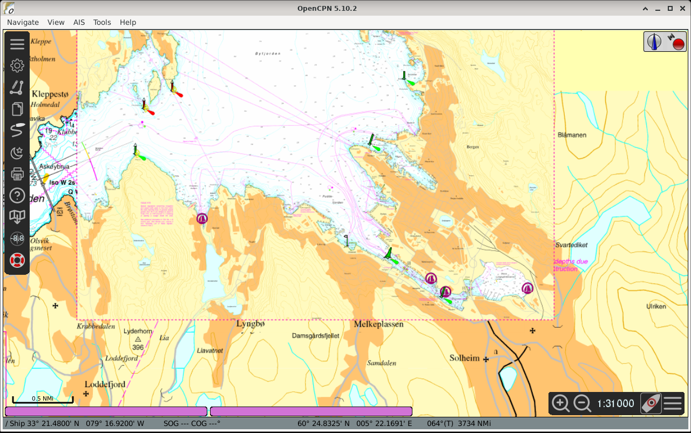

# Chart Grabber user guide

## Contents

1. [What it is](#what-it-is)
2. [What problems it solves](#what-problems-it-solves)
3. [Install](#install)
4. [First chart in 2 minutes](#first-chart-in-2-minutes)
5. [Bundled charts](#bundled-charts)
6. [Everyday use](#everyday-use)
7. [Weather](#weather)
8. [At sea and on slow links](#at-sea-and-on-slow-links)
9. [Your own sources](#your-own-sources)
10. [Settings reference](#settings-reference)
11. [Troubleshooting](#troubleshooting)
12. [Help and licence](#help-and-licence)

## What it is

Chart Grabber is an OpenCPN plugin that downloads charts for use offline. You pick an area (the current view, a drawn rectangle or a corridor along a route), a chart source and the detail; the [Chart Grabber CLI](https://github.com/Sea-For-Friends/chart-grabber-cli) downloads it in the background. The result is added to OpenCPN as an MBTiles chart.

**Not official charts. Do not use for navigation alone. Respect the terms of use of each chart source.**

## What problems it solves

- **Plugin and CLI together.** Before, sailors typically downloaded tiles with SAS.Planet or Mobile Atlas Creator (MOBAC), sometimes processed them in QGIS, converted them into a format OpenCPN reads (MBTiles or KAP) and added the folder to OpenCPN. [Chart Grabber CLI](https://github.com/Sea-For-Friends/chart-grabber-cli) is an independent port of SAS.Planet ([sasgis/sas.planet.src](https://github.com/sasgis/sas.planet.src)) to C++ and Qt. It is not an official SAS.Planet project. Thanks to the SAS.Planet authors. Like SAS.Planet, it is GPL-3.0-or-later. Chart Grabber is not affiliated with MOBAC or QGIS. Now it is one dialog inside OpenCPN, and the chart appears in OpenCPN's chart list. Resume, Update and the weather refresh are handled too.
- **The plugin** is the OpenCPN side: the area (current view, drawn on the chart, or along a route), the estimate before you download, My charts and the settings.
- **The [Chart Grabber CLI](https://github.com/Sea-For-Friends/chart-grabber-cli)** is a standalone command-line program that downloads tiles and writes MBTiles without OpenCPN. Scripts, other chart plotters, a server or a Raspberry Pi without OpenCPN can use it, for example to refresh weather charts on a schedule (cron). See the [Chart Grabber CLI documentation](#chart-grabber-cli-documentation).

## Install

You need OpenCPN 5.10.2 or newer. The [Chart Grabber CLI](https://github.com/Sea-For-Friends/chart-grabber-cli) 2026.10.13, the program that does the download, is inside the plugin file on every system: **Import** is the only install step. Chart Grabber is not in OpenCPN's plugin catalog yet; once it is listed, the Plugin Manager can install and update it, until then (and always on Arch and CachyOS) use Import.

1. **Pick the tarball** for your system (full notes: the release's COMPAT.md):

   | System | `chartgrabber_pi-2026.10.6-` ... |
   |---|---|
   | Debian 13 x86-64 | `debian-x86_64-13-x86_64.tar.gz` |
   | Debian 13 arm64, Raspberry Pi OS trixie 64-bit | `debian-arm64-13-arm64.tar.gz` |
   | Debian 12, Ubuntu 24.04, Mint 22 (x86-64) | `debian-x86_64-12-x86_64.tar.gz` |
   | Debian 12 arm64, Raspberry Pi OS bookworm 64-bit, Ubuntu 24.04 arm64 | `debian-arm64-12-arm64.tar.gz` |
   | Ubuntu 26.04 x86-64 / arm64 | `ubuntu-x86_64-26.04-x86_64.tar.gz` / `ubuntu-arm64-26.04-arm64.tar.gz` |
   | Arch / CachyOS | `arch-x86_64-rolling-x86_64.tar.gz` / `cachyos-x86_64-rolling-x86_64.tar.gz` |
   | Windows 10 and newer | `windows-x86.tar.gz` |

   There is no build for Ubuntu 22.04.
2. **Import**: OpenCPN, Options, Plugins, **Import plugin...**, choose the tarball, enable Chart Grabber. To update, import the new tarball over the old one.
   OpenCPN 5.10.2 (Debian 12 and 13 packages) may show no Chart Grabber toolbar button until you press **OK** to close Options or restart OpenCPN; until then use the right-click menu **Chart Grabber: new chart of this view...**.
3. **Ubuntu 24.04**: its own OpenCPN (5.8.4) is too old; install OpenCPN from the OpenCPN PPA (`ppa:opencpn/opencpn`).

Debian 12: `sudo apt install -t bookworm-backports opencpn`.

The Linux file needs the graphics libraries `libopengl0`, `libglx0` and `libegl1`; OpenCPN's own package from Debian 12, Debian 13 or Ubuntu 24.04 installs them, a hand-built OpenCPN may not (Arch and CachyOS: `libglvnd`).

The plugin uses the CLI from its own folder first. A CLI you installed yourself (the `.deb` or the Windows zip of the [Chart Grabber CLI](https://github.com/Sea-For-Friends/chart-grabber-cli) releases, for scripts and automation) is used only when you choose it in [Settings](#settings-reference).

**Updating from 2026.10.4 or older** (those needed a separately installed CLI): import the new tarball over the old one; nothing else is needed, and the separate CLI can be removed unless you use it in scripts. If you once chose a CLI under Settings, Advanced, **Chart Grabber CLI**, the plugin keeps using that one: click **Use default** in that row to switch to the CLI inside the plugin.

## First chart in 2 minutes

1. Move the chart to the area you want.
2. Click the **Chart Grabber** toolbar button, or right-click the chart: **Chart Grabber: new chart of this view...**. The **New chart** page opens with **Current view**.
3. Pick a source under **Chart** (**More sources...** lists all of them).
4. The estimate appears by itself: "About ... tiles, ... to download, ... on disk (... free)".
5. Press **Download**. A strip shows progress.
6. At "Chart added", press **Show**. If the chart is not visible, click it in the chart bar at the bottom. MBTiles charts need OpenGL (Options > Display > Advanced).

## Bundled charts

28 sources come with the plugin, in seven groups (the menus under **Chart**).

| Group | Source | What it is for | Area |
|---|---|---|---|
| Nautical charts | Norway sea chart (Kartverket, not for navigation) | Planning passages along the coast and skerries | Norway |
| Nautical charts | Finland sea chart (Traficom, not for navigation) | Planning archipelago routes and harbour approaches | Finland |
| Nautical charts | NOAA chart (US coast, not for navigation) | US chart picture for planning; for ENC, OpenCPN's Chart Downloader | US coast |
| Seamarks and traffic | OpenSeaMap Seamarks | Buoys, lights and beacons on top of any chart | Worldwide |
| Seamarks and traffic | EMODnet vessel density 2023, all ship types (AIS, European seas) | Where the shipping lanes and busy waters are, 2023 average | European seas |
| Seamarks and traffic | EMODnet vessel density 2023, sailing and pleasure craft (AIS, European seas) | Popular yacht routes and cruising grounds, 2023 average | European seas |
| Depth | EMODnet Bathymetry (European seas, depth shading) | Planning approaches and anchoring depths; not for navigation | European seas |
| Depth | EMODnet Bathymetry (world) | Seabed depths for passage planning; not for navigation | Worldwide |
| Depth | GEBCO bathymetry (world) | Coarse ocean depth: shelf edge, seamounts; not for navigation | Worldwide |
| Depth | NOAA BlueTopo bathymetry (US coast) | Nearshore depths for approaches and anchoring; not for navigation | US coast |
| Satellite | Sentinel-2 Cloudless 2025 (EOX) | Reef edges, banks, passes where charts are poor | Worldwide |
| Satellite | USGS Imagery (USA) | Reef edges, banks and pass entrances in US waters | USA |
| Satellite | Esri World Imagery (greyed) | Sharper reef and anchorage imagery; greyed by Esri's terms | Worldwide |
| Coast and land | OpenTopoMap (greyed) | Coastline, hills and landmarks ashore; greyed at server's request | Worldwide |
| Weather now | DWD weather radar (Germany, North Sea and western Baltic coasts) | Rain showers coming your way, new every 5 min | German coasts |
| Weather now | EUMETSAT MTG GeoColour (Europe, Africa, Atlantic; clouds day and night) | Clouds and fronts day and night, new every 10 min | Europe, Africa, Atlantic |
| Weather now | EUMETSAT H SAF precipitation rate H60B (Europe, Africa, Atlantic) | Where it is raining now, new every 15 min | Europe, Africa, Atlantic |
| Weather now | NASA IMERG precipitation rate (30 min, worldwide) | Rain offshore, beyond radar range; about 6 hours old | Worldwide |
| Weather now | NASA VIIRS NOAA-20 true colour (daily, clouds) | Daily cloud photo; today's may not cover you yet | Worldwide |
| Weather now | NOAA nowCOAST clouds, infrared (worldwide) | Clouds and fronts offshore, day and night; 2-3 hours old | 60 N to 60 S |
| Weather now | NOAA nowCOAST NWS watches and warnings (US) | US marine and storm warnings now, always fetched fresh | US land and coastal waters |
| Weather now | NOAA nowCOAST tropical cyclones (active storms) | Storm track and cone; empty when no storm is active | Where storms are active |
| Weather now | NOAA nowCOAST weather radar (contiguous US) | Rain and thunderstorms near US coasts now | US waters |
| Weather now | RainViewer radar (worldwide, current) | Rain near the coast now; none offshore; personal use | Worldwide, near radars |
| Ocean | NASA sea surface temperature (daily, MUR) | Gulf Stream and eddies before a crossing; 1-2 days old | Worldwide |
| Ocean | NASA sea ice concentration (daily, MUR) | Ice edge for high-latitude cruising | Polar seas |
| Ocean | NOAA RTOFS surface currents (eastern Pacific) | Model currents for planning a crossing; forecast, not measured | US West coast, eastern Pacific |
| Ocean | NOAA RTOFS surface currents (western Atlantic) | Model currents for planning a crossing; forecast, not measured | US East coast, western Atlantic |

- **Not for navigation**: everything in the Nautical charts and Depth groups is a picture of a chart or of depths, not a chart to navigate by.
- **Satellite**: Sentinel-2 (10 m) and USGS show reef edges, banks and passes, not single coral heads.
- **Greyed out**: Esri World Imagery, because Esri's terms say its imagery is "not intended to be used to export tiles for offline"; OpenTopoMap, because its server asks for no mass downloads. Reading the terms and complying is your responsibility.
- **Terms of use and credits** per source: [data/sources/README.md](../data/sources/README.md).

## Everyday use

- **Draw on chart**: drag a rectangle, or tap two corners. Right-click or **Cancel** to stop.
- **Along route**: pick a route and its **Corridor width** (0.5 to 20 NM, default 2.0).
- **Detail**: bands **Passage** and **Coastal** (on by default), **Approach**, **Harbour** (small areas only), each with its scale. The estimate says what one more level would add. Exact limits: **Advanced**, **Least detail** / **Most detail**.
- **Seamarks on top (OpenSeaMap)** adds buoys and lights over the chart.
- **My charts** lists your charts with detail, size, date and state. **Show** displays one; **More...** offers **Top up**, **Update...**, **Build from saved tiles**, **Delete**, **Show in folder**.
- **Stop** saves progress: "Stopped. Resume any time from My charts." **Resume** continues.
- **Update...** downloads again the tiles older than **Today (all tiles)**, **1 month**, **6 months** or **1 year**.

## Weather

- Tick **Weather on top** and pick a layer (rain radar, clouds, precipitation). It is made as its own chart.
- Radar reaches about 80-130 NM off the coast; far offshore only satellite pictures show the weather.
- In My charts, **More...**, **Update to latest weather** takes the newest picture as a new chart named with its time.

## At sea and on slow links

- **Offline**: finished charts need no connection. **Build from saved tiles** remakes a chart from tiles already on disk.
- **Saved tiles** let Top up and Resume fetch only what is missing; Settings, **Clear...** frees the space.
- **Slow or paid by the MB (mobile data, satellite)**: one connection, no automatic retries, and a **Limit per download** (default 100 MB): a larger download asks first, a running one stops at the limit ("Stopped at your data limit (100 MB). Resume to continue.").
- **Retries**: otherwise a lost connection pauses the download and retries 3 times, 60 s apart ("No connection. Retry in 60 s (1 of 3)"); then "No connection. Download paused; your progress is saved."

## Your own sources

- The 28 sources that come with the plugin: [Bundled charts](#bundled-charts).
- Add your own `.zmp` source folders to `Charts/Chart sources` in your home folder (Settings, **Chart sources**, **Open folder** creates it), or **Change...** to another folder. They are read after the bundled ones.
- Sources that need a key, and Navionics, are not bundled: put the source folder there and enter your key where its file says `KEY`.

## Settings reference

OpenCPN, Options, Plugins, Chart Grabber, **Preferences**.

| Setting | Default | Meaning |
|---|---|---|
| Chart sources | `Charts/Chart sources` in your home | Your own `.zmp` sources |
| Slow or paid by the MB | off | One connection, no retries, data limit |
| Limit per download | 100 MB | Asks first, then stops |
| Saved tiles, **Clear...** | | Space used; deletes saved tiles |
| Save charts in (Advanced) | `Charts/ChartGrabber` in your home | Where new charts go |
| Saved tiles in (Advanced) | OpenCPN's data folder | Where tiles are kept |
| [Chart Grabber CLI](https://github.com/Sea-For-Friends/chart-grabber-cli) (Advanced) | the one inside the plugin | The program, if you want another one |
| Add new charts to OpenCPN's chart list | on | Registers new charts |
| Warn before very large or very small detail choices | on | Asks before extreme detail |
| Show download progress on the chart | off | Off: progress in its own small window |
| Log file, **Open** | | For problem reports |
| Debug: write more detail to the log file | off | For problem reports |

## Troubleshooting

| Symptom | Fix |
|---|---|
| "[Chart Grabber CLI](https://github.com/Sea-For-Friends/chart-grabber-cli) was not found" | Import the plugin file of this release again (the CLI is inside it), or choose the CLI under Advanced in Settings. |
| "[Chart Grabber CLI](https://github.com/Sea-For-Friends/chart-grabber-cli) ... is too old" | Import the plugin file of this release (it carries CLI 2026.10.13), or choose a CLI 2026.10.9 or newer under Advanced in Settings. |
| Chart added but not visible | Click it in the chart bar; turn on OpenGL (Options > Display > Advanced). |
| Source greyed in More sources, or Seamarks on top disabled | It cannot be made into an OpenCPN chart; the text beside it says why. |
| "Area too large for this detail" | Choose a smaller area or less detail. |
| No Chart Grabber button on the toolbar | OpenCPN 5.10.2 adds it only at startup or on Options **OK**: press OK or restart OpenCPN. Meanwhile right-click the chart: **Chart Grabber: new chart of this view...**. |
| Import plugin refuses the tarball | Check the [system table](#install) and OpenCPN 5.10.2 or newer. |

## Help and licence

- With a problem report, send the log file (Settings, Advanced, **Log file**, **Open**) and the strip's **Details** text.
- **[Chart Grabber CLI](https://github.com/Sea-For-Friends/chart-grabber-cli) documentation**: the [CLI guide](https://github.com/Sea-For-Friends/chart-grabber-cli/tree/main/docs/user), [making your own chart sources](https://github.com/Sea-For-Friends/chart-grabber-cli/blob/main/docs/user/sources-tutorial.md) and [example sources](https://github.com/Sea-For-Friends/chart-grabber-cli/tree/main/docs/user/examples/sources). From the next CLI release, the .deb carries these documents in `/usr/share/doc/chart-grabber-cli/` and the Windows zip in its `docs` folder.
- Changes: [CHANGELOG](../CHANGELOG.md).
- GPL-3.0-or-later ([LICENSE](../LICENSE)); chart source definitions CC0-1.0 ([licence](../data/sources/LICENSE)).
